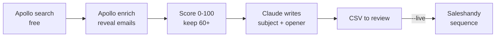

# GTM workflow for an AI voice assistant

Finds businesses that miss a lot of phone calls, picks the best-fit people,
writes each one a personal email opener, and loads them into a Saleshandy
email sequence.



## How it works

1. **Prospecting (Apollo People Search).** Searches for decision makers
   (owners, founders, practice and operations managers) at 5-200 employee
   companies in call-heavy industries: dental and medical clinics, real
   estate, HVAC, plumbing, legal and insurance. Search does not use credits.
2. **Enrichment (Apollo Bulk Match).** Reveals work emails and company
   details in batches of 10. This uses Apollo credits, so `--limit` caps it.
3. **Lead scoring.** Each lead gets a 0-100 fit score: call-heavy industry
   (35), decision-maker title (25), company size fit (20), verified email
   (15) and website present (5). Leads below `min_score` (default 60) or
   without an email are dropped.
4. **Personalisation (Claude).** Claude Opus 5.5 writes a subject line,
   opening line and likely pain point for each lead, using structured output
   and only the facts provided. Without an API key, industry templates are
   used instead.
5. **Sequencing (Saleshandy).** Qualified leads are imported into a
   3-step sequence that stops automatically when a prospect replies.

Every run writes a CSV for review first. Nothing is sent to Saleshandy
unless you pass `--live`.

## Setup

```bash
pip install -r requirements.txt
cp .env.example .env          # then put your keys in .env
python main.py demo           # try it with sample data, no keys needed
```

1. **Apollo key**: Apollo > Settings > Integrations > API Keys.
2. **Saleshandy**:
   - Create a 3-step sequence using [templates/sequence.md](templates/sequence.md).
   - Create custom prospect fields `first_line` and `pain_point`.
   - Put your API key in `.env`, then run `python main.py sequences` to find the
     step ID (`SALESHANDY_STEP_ID`) and `python main.py fields` to find the
     field IDs. Paste the field IDs into [config/icp.yaml](config/icp.yaml).
3. **Claude key (optional)**: without it, openers come from simple templates.
4. **Your product**: edit the `product` section of `config/icp.yaml`.

## Run it

```bash
python main.py run              # find, score, write openers -> output/leads_YYYYMMDD.csv
python main.py run --limit 10   # enrich fewer people (saves Apollo credits)
python main.py run --live       # same, then add the leads to Saleshandy
python -m unittest discover -s tests -t .
```

People already sent are remembered in `output/seen.json`, so a person never
enters the sequence twice.

## Run it every week (GitHub Actions)

[.github/workflows/gtm.yml](.github/workflows/gtm.yml) runs every Monday at
09:00 IST and uploads the CSV as a build artifact.

1. Repo > Settings > Secrets and variables > Actions > add secrets:
   `APOLLO_API_KEY`, `SALESHANDY_API_KEY`, `SALESHANDY_STEP_ID`, `ANTHROPIC_API_KEY`.
2. It starts in dry-run mode. To send for real, add the repository variable
   `GTM_LIVE = true`, or run it by hand from the Actions tab and tick **live**.

## What's where

| File | Job |
|---|---|
| `config/icp.yaml` | Who to target, scoring rules, product pitch, Saleshandy field IDs |
| `gtm/apollo.py` | Apollo People Search + bulk enrichment |
| `gtm/scoring.py` | The 0-100 fit score |
| `gtm/personalize.py` | Claude (Opus 5.5) writes subject, opener and pain point, with template fallback |
| `gtm/saleshandy.py` | Imports prospects into a sequence step |
| `gtm/pipeline.py` | Runs the five steps in order |
| `templates/sequence.md` | Email copy for the 3-step sequence |

## Notes

- Apollo search is free, but enrichment uses credits: `--limit` caps it.
- Saleshandy's `/v1/fields` endpoint used by `python main.py fields` wasn't
  documented in the pages checked while building this. If it fails, copy the
  field IDs from Saleshandy's API reference or your account settings.
- Send cold email only where it's legal (CAN-SPAM in the US, GDPR in the
  EU/UK) and always keep the unsubscribe link Saleshandy adds.
